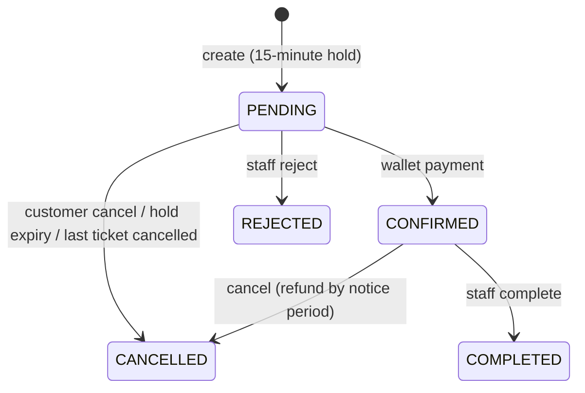

# Software Engineering Documentation

Index of the engineering artifacts. See [System Personas](PERSONAS.md) for the actors.

| Artifact | Where |
| --- | --- |
| Requirements | [Tour management requirement catalog](use-cases/tour-management-requirements.md) |
| Use cases | [use-cases](use-cases/README.md) - actor, preconditions, main and failure flows, result |
| Workflow rules | Business-logic sections of [server services](server/services/README.md) (booking, inventory, tickets, tours, users, payments) |
| State machines | [TourService](server/services/tourmanagement/TourService.md) (tour), [TourReservationService](server/services/tourmanagement/TourReservationService.md) (reservation), [TicketService](server/services/tourmanagement/TicketService.md) (ticket) |
| Data model | [server/models](server/models/README.md) with the relationship table |
| API contract | [server/controllers](server/controllers/README.md) and [errors](server/globals/errors.md) |
| Security | [security](security/README.md) |
| Verification | [verification](verification/README.md) |

## Reservation states

## Tour states

```mermaid
stateDiagram-v2
    [*] --> PENDING
    PENDING --> APPROVED
    APPROVED --> ACTIVE: places reset to capacity
    ACTIVE --> COMPLETED: end date passed (nightly) or staff
    PENDING --> CANCELLED
    APPROVED --> CANCELLED
    ACTIVE --> CANCELLED: >= 14 days out and <= 1/3 booked; bookings refunded
    CANCELLED --> PENDING: restore
```

